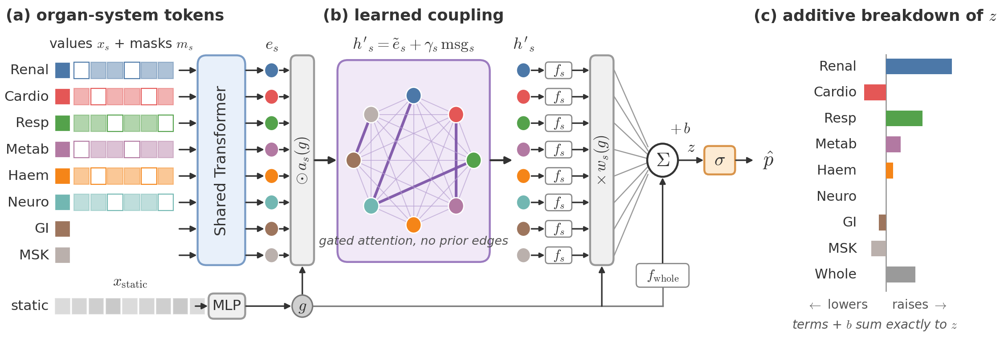

# Organ-System Transformers with Additive Fusion for Mortality Prediction

Code and documentation for the preprint *Organ-System Transformers with Additive Fusion for
Mortality Prediction: Evaluation on an INSPIRE Subset* (Rajkumar, Pope, Ng).

**Task.** Predict in-hospital death within 30 days of the last operation, using only
information available before entering the operating room (5-day pre-operative window), in
the public INSPIRE peri-operative dataset.

**Idea.** Group inputs into eight organ systems, encode each with one shared transformer, and
fuse them additively, so every prediction comes with an exact per-system breakdown of the logit.

## Headline results (preprint subset)

Test set: 2,189 patients, 94 deaths (4.29%). 95% CIs from patient bootstrap.

| Model | AUROC | AUPRC |
|---|---|---|
| Organ-system DNN (single) | 0.962 (0.942–0.977) | 0.621 (0.514–0.717) |
| Organ-system DNN (ensemble of 3) | 0.963 (0.943–0.978) | 0.639 (0.529–0.748) |
| Gradient boosting | 0.957 | 0.621 (0.507–0.728) |
| 7-variable logistic regression (ASA, age, sex, emergency, NEWS2) | 0.940 (0.911–0.964) | 0.610 (0.514–0.707) |
| P-POSSUM (pre-operative items) | 0.839 (0.795–0.880) | 0.225 (0.163–0.310) |

**In one sentence:** discrimination matches strong tabular baselines, and the added value is an
exact, auditable organ-level decomposition of each prediction, whose specificity and
reproducibility we test explicitly (see [Results](paper/results.md)).

!!! note "Scope"
    All results use the preprint subset: every recorded death (942 records, 469 meeting the
    outcome) plus 10,000 randomly sampled survivors. This mortality-enriched subset is not a
    full-cohort evaluation; precision and AUPRC will be lower at the natural event rate (0.47%).

## Where to go

| Page | For |
|---|---|
| [Method](paper/method.md) | Architecture, inputs, training, and where each component lives in the code |
| [Results](paper/results.md) | Full comparison tables, calibration, explanation checks, cross-learning ablation |
| [Reproduce](paper/reproduce.md) | Environment, data access, and the exact commands for every number |
| Project notes / Archive (tabs) | Development history, clinical notes and earlier designs; not needed to review the paper |
