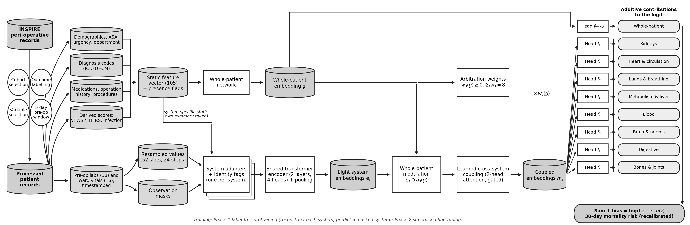

# Method

## Prediction target

- **Unit:** one patient, anchored to the last operation (latest operating-room entry).
- **Inputs:** labs and ward vitals from the 5 days before that operation; static information
  (demographics, ASA, urgency, department, diagnoses, frailty score, NEWS2 summaries, medications,
  operation history).
- **Label:** in-hospital death within 30 days of leaving the operating room.

## Model

| Component | What it does | Code |
|---|---|---|
| Organ-system tokens | 8 systems. Six (renal, cardiovascular, respiratory, metabolic/hepatic, haematology, neurological) get 24 value/mask time steps plus a summary token; GI and MSK get a summary token from diagnosis codes and department | [`03_organ_system_features.py`][stage03] |
| Shared transformer | One transformer (32-d, 4 heads, 2 layers) encodes every system separately: same weights, no information exchange | [`OrganSystemEncoder`][layers] |
| Whole-patient layer | Reads all static features; rescales each system embedding ($a_s(g) \in [0.5, 1.5]$) and adds its own term | [`WholePatientLayer`][layers] |
| Cross-system coupling | Gated 2-head attention: each system receives messages from the other seven; no prior links | [`SystemCouplingLayer`][layers] |
| Arbitration | Patient-specific weights $w_s(g) \ge 0$, mean 1 | [`SystemArbitrationLayer`][layers] |
| Additive fusion | $z = b + f_{\text{whole}}(g) + \sum_s w_s(g)\, f_s(h'_s)$; the terms reconstruct the logit exactly | [`NAMFusion`][layers] |

## Training

1. **Label-free pre-training:** reconstruct each system's own inputs, and predict a masked
   system from the others.
2. **Supervised fine-tuning:** weighted cross-entropy with a balanced sampler, after grouped
   SMOTENC on static features and sequence augmentation (training split only).

Model selection uses validation AUPRC. The operating threshold and a logistic recalibrator are
fitted on validation predictions only.

## Evaluation

- Stratified 60/20/20 patient split (seed 42); no synthetic records in validation or test.
- AUROC and AUPRC (average precision), with 95% CIs from 1,000 patient-bootstrap resamples.
- Clinical baselines (ASA, NEWS2, emergency flag, logistic regressions, pre-operative POSSUM)
  are scored on the identical test patients, with paired bootstrap differences.

[stage03]: https://github.com/thrisharajkumar/inspire-analysis-thrisha/blob/main/src-dnn/pipeline/03_organ_system_features.py
[layers]: https://github.com/thrisharajkumar/inspire-analysis-thrisha/blob/main/src-dnn/inspire_dnn/layers.py
