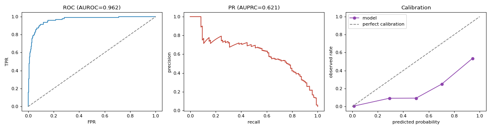
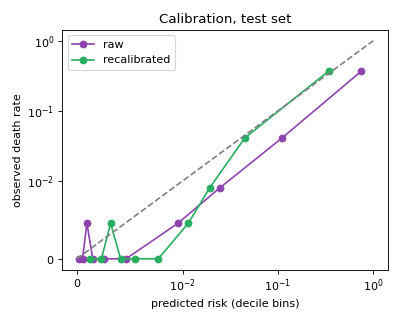
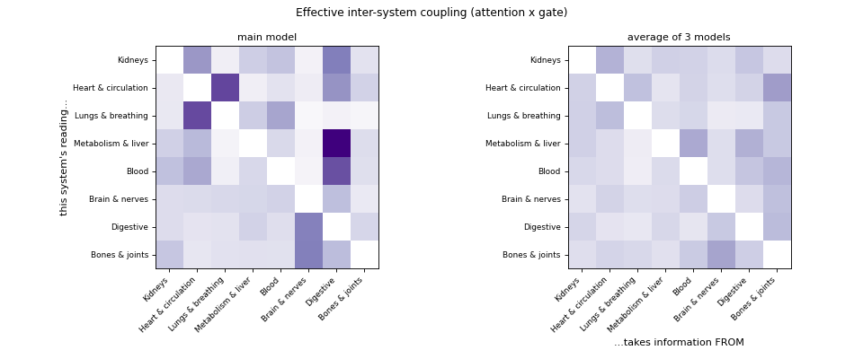

# Results (preprint subset)

Test set: 2,189 patients, 94 deaths (4.29%); chance AUPRC 0.043. Intervals are 95% patient
bootstrap. Comparison models share the patient split and source features.

## Discrimination

| Model | AUROC | AUPRC |
|---|---|---|
| Organ-system DNN (single) | 0.962 (0.942–0.977) | 0.621 (0.514–0.717) |
| Organ-system DNN (ensemble of 3) | 0.963 (0.943–0.978) | 0.639 (0.529–0.748) |
| Histogram gradient boosting | 0.957 | 0.621 (0.507–0.728) |
| Logistic regression (all features) | 0.933 | 0.552 (0.437–0.660) |
| **Clinical baselines** | | |
| ASA class alone | 0.840 (0.798–0.885) | 0.354 (0.272–0.442) |
| Emergency flag alone | 0.746 (0.695–0.798) | 0.146 (0.103–0.195) |
| Worst pre-op NEWS2 alone | 0.873 (0.830–0.911) | 0.454 (0.345–0.556) |
| POSSUM physiological score | 0.772 (0.717–0.824) | 0.163 (0.115–0.233) |
| P-POSSUM (pre-operative items) | 0.839 (0.795–0.880) | 0.225 (0.163–0.310) |
| LR: ASA + age + sex + emergency | 0.914 (0.877–0.944) | 0.485 (0.395–0.581) |
| LR: above + NEWS2 (7 variables) | 0.940 (0.911–0.964) | 0.610 (0.514–0.707) |

**Reading.** The DNN clearly exceeds single clinical scores and pre-operative POSSUM. It is
comparable to gradient boosting and to a 7-variable logistic regression, so its contribution is
the organ-level decomposition rather than higher discrimination.

## Operating point and calibration (single model)

| Quantity | Value |
|---|---|
| Threshold (max F1 on validation) | 0.698 |
| Sensitivity / precision | 75.5% / 51.1% (71 of 94 deaths; 68 false positives) |
| Brier score, raw / recalibrated | 0.0407 / 0.0238 |
| Mean predicted risk, raw / recalibrated (observed 4.29%) | 9.09% / 4.41% |

At the natural event rate (0.47%), the same sensitivity and specificity would give about 10%
precision (an arithmetic projection, not a measured result).

## Is the explanation trustworthy?

- **Exact accounting:** the per-system terms plus bias reconstruct the logit exactly. The
  whole-patient term carries 11% of absolute contributions; the eight systems carry 89%.
- **System specificity:** shuffling a system's own inputs vs other systems' inputs. Share of
  change due to own inputs: renal 0.80, cardiovascular 0.91, respiratory 0.72, metabolic 0.84,
  haematology 0.80, GI 0.73, **neurological 0.17, MSK 0.34**. The last two depend mostly on
  other systems.
- **Reproducibility of learned links:** coupling rankings do not replicate across seeds
  (Spearman −0.10 and −0.25; no shared top-5 link). Heart→kidney ranks 9 of 56 in one model.

## Cross-learning ablation (A/B/C)

Does information sharing between organ systems help? Three models trained with the same recipe
and seed on the same split:

| Model | Coupling | Whole-patient + arbitration |
|---|---|---|
| A: isolated organs | off | off |
| B: + cross-learning | on | off |
| C: full model | on | on |

!!! info "Results pending"
    The ablation is running. Paired differences (B − A, C − B) and comparisons with P-POSSUM
    will be added here. Run it yourself with [Reproduce → Ablation](reproduce.md#4-cross-learning-ablation-and-possum).

## Limitations

- Mortality-enriched, single-centre subset; no external or full-cohort validation yet.
- "Last operation" anchoring uses information not available prospectively.
- 48 ASA VI patients (brain-dead organ donors) account for 47 of 469 deaths; excluding them from
  the test set lowers every model's AUPRC (7-variable LR: 0.610 → 0.513).
- POSSUM is a pre-operative approximation; NELA was not evaluated (it is validated only for
  emergency laparotomy).
- Synthetic oversampling shifts NEWS2 distributions (KS 0.36); learned links are not
  reproducible across seeds.
